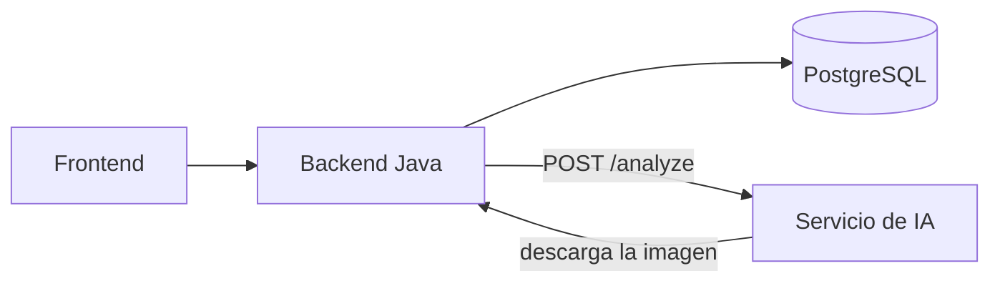

# Render.IA — Servicio de IA

Componente de inteligencia artificial de **Render.IA**: recibe la imagen de un plano 2D y devuelve los elementos estructurales que encuentra (muros, columnas, vigas, losa, puertas y ventanas), con sus medidas en metros y un nivel de confianza.

Proyecto final de **Patrones de Software** — Universidad Cooperativa de Colombia, sede Pasto.

- **Integrantes:** Juan David Moreno, Felipe Cerón
- **Backend:** [renderia-backend](https://github.com/Render-ia/renderia-backend) (Java 21 + Spring Boot)
- **Frontend:** [renderia-frontend](https://github.com/Render-ia/renderia-frontend)
- **Base de datos:** [renderia-database](https://github.com/Render-ia/renderia-database)

## Lugar en la arquitectura



El backend le pide el análisis a este servicio, este descarga la imagen del plano desde el backend, la analiza y devuelve los elementos. El backend los guarda en `ai_analyses` y `structural_elements`.

El servicio es **independiente**: se puede cambiar de modelo de IA sin tocar el backend, el frontend ni la base de datos.

## Endpoints

| Método | Ruta | Descripción |
|---|---|---|
| GET | `/health` | Estado del servicio |
| GET | `/models` | Proveedores de IA disponibles |
| POST | `/analyze` | Analiza un plano |

### POST /analyze

```json
{
  "imageUrl": "https://renderia-backend.onrender.com/api/v1/floor-plans/1/image",
  "scale": "1:100",
  "provider": "local-vision",
  "modelIdentifier": "renderia-vision-v1"
}
```

Respuesta:

```json
{
  "provider": "local-vision",
  "model": "Detector de visión local",
  "durationMs": 412,
  "elements": [
    { "type": "Muro", "material": "Ladrillo", "startX": 0.64, "startY": 0.8, "endX": 2.3, "endY": 0.8,
      "width": null, "height": 2.5, "thickness": 0.15, "confidence": 0.71 }
  ],
  "summary": { "counts": { "walls": 18, "columns": 11, "doors": 6, "windows": 5, "beams": 15 } }
}
```

Errores: `400` si la petición está mal, `401` si falta la clave, `422` si el plano no se puede analizar (por ejemplo, si está en blanco). El cuerpo siempre es `{ "message": "..." }` en español.

## Modelos disponibles

| `provider` | Nombre | Cómo funciona |
|---|---|---|
| `local-vision` | Detector de visión local | Visión por computador clásica (ver abajo) |
| `mock` | Respuesta de ejemplo | Devuelve siempre la casa de ejemplo; sirve para probar el flujo |

### Detector de visión local

1. Convierte la imagen a blanco y negro con el **umbral de Otsu**.
2. Mide el **grosor típico de muro** con la longitud más común de los trazos.
3. Quita líneas delgadas (texto, cotas, arcos de puertas) con una **apertura morfológica**.
4. Busca **muros** como bandas de trazos largos alineados.
5. Encuentra **columnas** erosionando la imagen: los muros desaparecen y quedan los cuadros gruesos.
6. Deduce **puertas y ventanas** de los huecos entre tramos de un muro, **vigas** entre columnas unidas por un muro y la **losa** con el contorno del edificio.
7. Pasa de píxeles a metros con la escala del dibujo (escaneo a 150 ppp).

Con `samples/plano-casa.svg` a escala 1:100 encuentra 18 muros, 11 columnas, 6 puertas, 5 ventanas, 15 vigas y la losa (lo comprueban las pruebas).

## Patrones de diseño

| Patrón | Dónde | Para qué |
|---|---|---|
| **Strategy** | `PlanAnalyzer` → `LocalVisionAnalyzer`, `SampleAnalyzer` | Cada modelo de IA analiza el plano a su manera detrás de la misma interfaz |
| **Factory** | `AnalyzerFactory` | Elige el analizador según `ai_models.provider`: el "switch" de modelos |
| **Facade** | `AnalysisService` | Una sola llamada valida, descarga la imagen, elige el modelo y lo ejecuta |

### Cómo agregar otro modelo

1. Crear una clase en `src/analyzers/` que implemente `PlanAnalyzer`.
2. Registrarla en `AnalyzerFactory`.
3. Agregar la fila en la tabla `ai_models` con el mismo `provider` y activarla desde el panel de administración.

## Seguridad

- Solo descarga imágenes de las URL permitidas en `IMAGE_URL_PREFIXES` (por defecto, el backend), con un máximo de 10 MB y 30 segundos.
- Si se define `AI_API_KEY`, `/analyze` exige esa clave en el encabezado `X-API-Key`. El backend la envía; nadie más puede usar el servicio.

## Variables de entorno

| Variable | Por defecto | Para qué |
|---|---|---|
| `PORT` | `8000` | Puerto del servidor |
| `AI_API_KEY` | vacío | Clave compartida con el backend |
| `IMAGE_URL_PREFIXES` | backend de Render y `localhost:8080` | Desde dónde se pueden descargar imágenes |

## Cómo ejecutarlo

```bash
npm install
npm test          # compila y corre las pruebas
npm start         # http://localhost:8000/health
```

## Tecnologías

Node.js 22, TypeScript, [sharp](https://sharp.pixelplumbing.com/) para leer PNG, JPG, WEBP y SVG, Docker y GitHub Actions.
